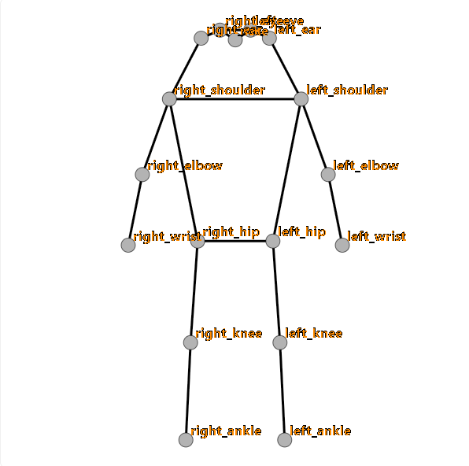
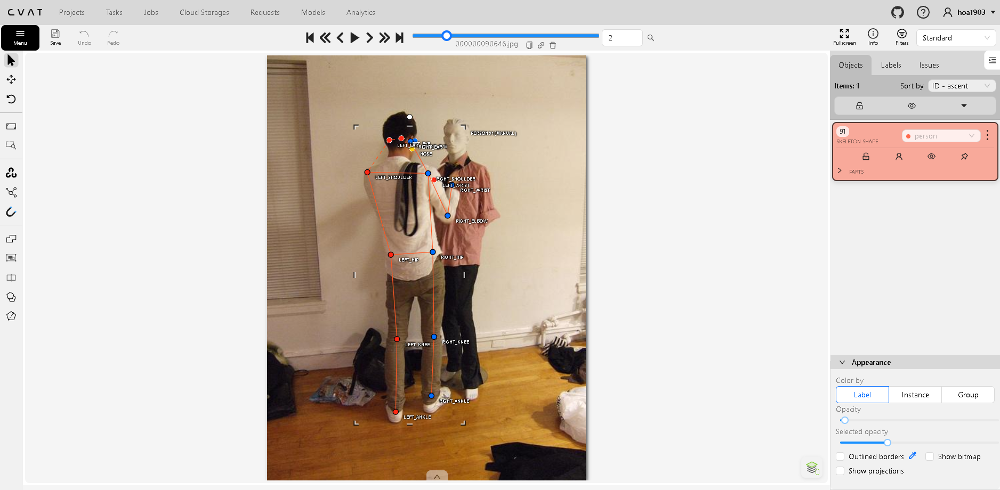
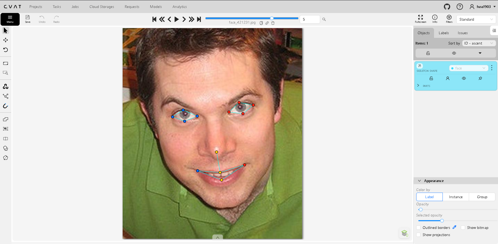
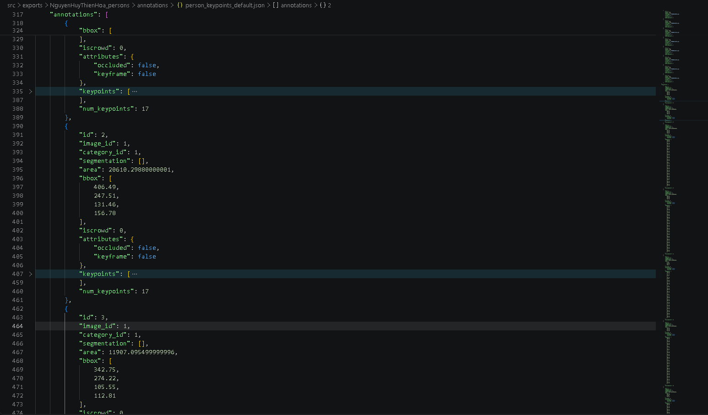

# Báo cáo cá nhân — HoVaTen-MSSV

Đổi tên file theo quy tắc `MSSV_HoTen.md`. Ví dụ: `20241234_NguyenVanAn.md`.

Dữ liệu: 12 ảnh người COCO val2017 (Lin et al., 2014) và 8 ảnh chân dung Wikimedia Commons, chỉ dùng trong lớp.

## 0. Thông tin học viên

- Họ tên:Nguyễn Huy Thiên Hòa
- MSSV:2A202604035
- Email:hoa76lqd@gmail.com
- Link repository:https://github.com/HoaNguyen1903/K5-L2B-Day04-NguyenHuyThienHoa-2A202604035-KeypointPose-Student
- Phiên bản CVAT (Help → About):2.74.1
- Máy: hệ điều hành Window · RAM 16 GB · chạy CVAT chế độ đầy đủ
- Bộ ảnh (`src/exports/assignment.json` do `lab.py setup` tạo): có
- Giờ bắt đầu:4h38
- Giờ kết thúc:6h00

## 1. Kiểm tra label (CP0)

| Label | Kiểu | Số điểm | Tên điểm đúng bảng của lab? | Đúng thứ tự? | Số cạnh |
|---|---|---:|---|---|---:|
| `person` | skeleton | 17 | có | có | 19 |
| `face` | skeleton | 13 | có | có | 13 |

Mẫu `person` dựng theo người quay mặt về camera (các điểm `left_*` nằm bên phải khung mẫu)? Có

Cách đổi cờ `occluded` / `outside` cho **một điểm** trên phiên bản CVAT này (một câu): toggle occluded bằng Q, toggle outside bằng O

...

## 2. Số lượng đã gán và thời gian (CP1, CP2)

| Nhóm ảnh | Số ảnh | Số skeleton đã gán | Số người dưới 60 px (không gán) | Số poster / gương / màn hình bỏ qua | Thời gian (phút) |
|---|---:|---:|---:|---:|---:|
| `easy` | 5 | 5 | 0 | 0 | 5 |
| `occluded` | 3 | 5 | 0 | 0 | 6 |
| `back` | 2 | 4 | 0 | 0 | 4 |
| `small` | 1 | 0 | 1 | 0 | 1 |
| `crowd` | 1 | 3 | 0 | 0 | 10 |
| `faces` | 8 | 8 | — | 0 | 8 |

- Số ảnh người đã xong ở mốc phút 105: 12 / 10
- Thời gian thực tế (phút): CP1 35 · CP2 15 · CP3 10
- Ảnh tốn thời gian nhất là ảnh nào, vì sao?
000000012552.jpg, vì có nhiều skeleton phải vẽ nhất, cũng là ảnh đầu tiên nên chưa quen thao tác
...

## 3. Bảng ca khó (CP1, CP2)

Mỗi điểm bạn phân vân một dòng, nhất là phân vân giữa `v = 1` và `v = 0`, hoặc không chắc hướng người.

| Ảnh | Người / mặt | Điểm | Cờ đã chọn | Phân vân giữa | Lý do chọn |
|---|---|---|---:|---|---|
|000000147780.jpg | Người | #2 Right_ankle | occluded | v=2 và v=1 | sau cùng vẫn nhìn rõ |
|000000177338.jpg | Người | #1 Elbow | occluded | v=0 và v=1 | không thấy được, suy luận được bằng vị trí vai và cổ tay |
|face_324513.jpg | Mặt | Các điểm mắt | occluded | v=0 và v=1 | đọc lại file hướng dẫn thấy kính râm thì v=1 |

## 4. Bảng tự review (CP3)

Đi từ ảnh cuối về ảnh đầu. 5 ảnh người (ít nhất 2 ảnh `back` hoặc `crowd`) và 3 ảnh mặt. Ít nhất 8 dòng, kể cả dòng `ok`. Ghi lỗi trước, sửa sau.

Mã lỗi dùng đúng một trong: `lr_swap`, `vis_flag`, `position`, `missing`, `extra`, `ok`.

| Ảnh | Người / mặt | Điểm | Mã lỗi | Ghi chú | Đã sửa? |
|---|---|---|---|---|---|
|000000012552.jpg | Người | Ankles |lr_swap |Skeleton không có vấn đề |Không |
|000000164659.jpg | Người | Ankles |lr_swap |Skeleton không có vấn đề |Không |
|000000177338.jpg | Người | Cả người |lr_swap |Nhầm hướng |Đã sửa |
|000000311300.jpg | Người | Ankles |lr_swap |Skeleton không có vấn đề |Không |
|000000323705.jpg | Người | Ankles |lr_swap |Skeleton không có vấn đề |Không |
|face_125051.jpg | Mặt | Không có | Không có | Không có | Không |
|face_223746.jpg | Mặt | Không có | Không có | Không có | Không |
|face_362568.jpg | Mặt | Không có | Không có | Không có | Không |

Tổng hợp số lỗi theo mã:

| `lr_swap` | `vis_flag` | `position` | `missing` | `extra` | `ok` |
|---:|---:|---:|---:|---:|---:|
| 5 | 0 | 0 | 0 | 0 | 13 |

Điểm còn phân vân giữa `v = 1` và `v = 0` (ghi cả hai lựa chọn và lý do chọn):

...

## 5. Kiểm file xuất và kết quả tự kiểm (CP4)

Tự kiểm tay trong file JSON:

| File | Người / mặt kiểm (ảnh, thứ tự) | Số phần tử `keypoints` | Điểm `outside` ra `v = 0`, `occluded` ra `v = 1`? | `num_keypoints` khớp? |
|---|---|---:|---|---|
| `NguyenHuyThienHoa_persons.zip` | 000000012552.jpg, người #1 | 51 | Đúng (v=0: 31 điểm, v=1: 61 điểm) | 15.2 |
| `NguyenHuyThienHoa_faces.zip` | face_125051, mặt #1 | 39  | Đúng (v=0: 1 điểm, v=1: 16 điểm) | 12.9 |
| `NguyenHuyThienHoa_bonus_persons.zip` | 000000188948.jpg, người #2 | 51 | Đúng (v=0: 29 điểm, v=1: 32 điểm) | 13.4 |
| `NguyenHuyThienHoa_bonus_faces.zip` | face_102517, mặt #1 | 39 | Đúng (v=0: 0 điểm, v=1: 3 điểm) | 13 |

Sau khi xuất, CVAT ghi `occluded` thành `v = 1` và `outside` thành `v = 0`. Tọa độ của điểm `outside` trong file là `0, 0` hay tọa độ cũ? Tọa độ cũ

Hai job đã chuyển sang completed trên CVAT? Có

Dán phần **TÓM TẮT** in ra từ `src/check_submission.py`:

Bài chính:

```text
- File person: NguyenHuyThienHoa_persons.zip
  Số ảnh: 12 · số skeleton `person`: 17 · mỗi annotation 51 số
  Skeleton theo ảnh: 000000012552=3, 000000069971=2, 000000090646=1, 000000147780=2, 000000150500=1, 000000164659=1, 000000177338=2, 000000177889=1, 000000241837=1, 000000311300=2, 000000323705=0, 000000399983=1
  Cờ v: v=2 197 (68%) · v=1 61 (21%) · v=0 31 (11%)
  num_keypoints trung bình: 15.2
- File face: NguyenHuyThienHoa_faces.zip
  Số ảnh: 8 · số skeleton `face`: 8 · mỗi annotation 39 số
  Skeleton theo ảnh: face_125051=1, face_223746=1, face_324513=1, face_362568=1, face_41666=1, face_421231=1, face_449454=1, face_514826=1
  Cờ v: v=2 87 (84%) · v=1 16 (15%) · v=0 1 (1%)
  num_keypoints trung bình: 12.9
- Ghi chú: 32 điểm v = 0 vẫn mang tọa độ cũ (CVAT 2.x xuất như vậy; chuẩn COCO ghi 0, 0). Không phải lỗi: điểm v = 0 bị bỏ qua khi huấn luyện và khi chấm.
- Số [LỖI]: 0 · số [CẢNH BÁO]: 5
Kết quả: ĐẠT (đọc lại từng cảnh báo ở trên)
```

Bài bonus :

```text
- File person: NguyenHuyThienHoa_bonus_persons.zip
  Số ảnh: 3 · số skeleton `person`: 8 · mỗi annotation 51 số
  Skeleton theo ảnh: 000000065350=2, 000000188948=3, 000000323525=3
  Cờ v: v=2 75 (55%) · v=1 32 (24%) · v=0 29 (21%)
  num_keypoints trung bình: 13.4
- File face: NguyenHuyThienHoa_bonus_faces.zip
  Số ảnh: 5 · số skeleton `face`: 5 · mỗi annotation 39 số
  Skeleton theo ảnh: face_102517=1, face_274219=1, face_280788=1, face_45276=1, face_507166=1
  Cờ v: v=2 62 (95%) · v=1 3 (5%) · v=0 0 (0%)
  num_keypoints trung bình: 13.0
- Ghi chú: 29 điểm v = 0 vẫn mang tọa độ cũ (CVAT 2.x xuất như vậy; chuẩn COCO ghi 0, 0). Không phải lỗi: điểm v = 0 bị bỏ qua khi huấn luyện và khi chấm.
- Số [LỖI]: 0 · số [CẢNH BÁO]: 1
Kết quả: ĐẠT (đọc lại từng cảnh báo ở trên)
```

Các `[CẢNH BÁO]` còn giữ nguyên và lý do:
Bài thường : 
  [CẢNH BÁO] 000000012552.jpg #1: cặp ankle nằm ngược phía so với các cặp còn lại. Có thể đổi trái/phải một cặp (`lr_swap`), hoặc tay / chân bắt chéo thật: kiểm lại.
  [CẢNH BÁO] 000000164659.jpg #1: cặp knee, ankle nằm ngược phía so với các cặp còn lại. Có thể đổi trái/phải một cặp (`lr_swap`), hoặc tay / chân bắt chéo thật: kiểm lại.
  [CẢNH BÁO] 000000311300.jpg #1: cặp ankle nằm ngược phía so với các cặp còn lại. Có thể đổi trái/phải một cặp (`lr_swap`), hoặc tay / chân bắt chéo thật: kiểm lại.
  [CẢNH BÁO] 000000311300.jpg #2: cặp ankle nằm ngược phía so với các cặp còn lại. Có thể đổi trái/phải một cặp (`lr_swap`), hoặc tay / chân bắt chéo thật: kiểm lại.
  [CẢNH BÁO] 000000323705.jpg: không có skeleton `person` nào. Ảnh nào cũng có ít nhất một người cần gán.

  Lý do : Tay chân bắt chéo thật, ảnh 000000323705.jpg : có người cần gán nhưng nhỏ hơn 60px

Bài bonus :
   [CẢNH BÁO] 000000188948.jpg #2: trái/phải không nhất quán giữa các cặp điểm (shoulder, hip so với elbow, wrist). Kiểm `lr_swap`.

   Lý do : tay chân bắt chéo thật
...

## 6. Ảnh chụp màn hình

1. Label `person` trong label constructor (đủ 17 điểm có tên):

   

2. Một người quay lưng đã gán, cờ đã đặt:

   

3. Một khuôn mặt đã gán 13 điểm, phóng to vùng mắt:

   

4. Một đoạn JSON xuất của một người:

   
   

Nguồn ảnh: COCO val2017 / Wikimedia Commons.

## 7. Tự đánh giá

1. Lỗi bạn mắc nhiều nhất hôm nay, và cách bạn sẽ tránh ở dự án thật:

   1 lỗi là bị nhầm trái phải, sẽ để ý kĩ hơn

2. Một quy tắc bạn đề xuất thêm vào guideline (kèm ảnh ví dụ nếu có):

   Không có

3. Nhãn của bạn đi vào model ở đâu? Chọn một lỗi bạn đã sửa và nói nó sẽ làm model học sai thế nào (heatmap, trọng số trong loss, hay bước lật ảnh):

   Lỗi đã sửa ở ảnh 000000177338.jpg, bị nhầm trái phải dẫn đến lr_swap

   Lỗi này đi vào model qua heatmap. Mỗi điểm có v > 0 được dựng thành một đỉnh Gaussian tại (x, y) trong kênh của điểm đó. Với nhãn sai, kênh `left_<...>` có đỉnh ở bên phải của người, trong khi ở các ảnh khác cùng kênh đó có đỉnh ở bên trái. Cùng một kênh bị dạy hai vị trí đối nghịch, nên heatmap dự đoán bị chia thành hai đỉnh yếu hoặc nhòe, và model khó phân biệt được trái/phải.
   Lỗi này không nằm ở trọng số loss: cả hai điểm đều có v > 0 nên loss vẫn được tính, chỉ là tính so với đích sai. Vì vậy cờ v không giúp phát hiện được lỗi này.
   Lỗi cũng đi qua bước lật ảnh. Lật ngang hoán đổi kênh theo `flip_pairs` với giả định `left_*` là bên trái thật của người, nên bản lật của ảnh này tiếp tục mang nhãn sai. Một lỗi nhãn thành hai mẫu sai.
   Lỗi này không tự triệt tiêu, vì các ảnh còn lại gán đúng. Mẫu sai mâu thuẫn trực tiếp với chúng, nên phải sửa bằng `lr_swap` cho cặp đó.

   Heatmap: mỗi điểm có v > 0 được biến thành một đỉnh Gaussian tại (x, y) trong heatmap đích của kênh điểm đó. Tọa độ sai thì đỉnh đích đặt sai chỗ.
   Trọng số trong loss: điểm v = 0 bị bỏ qua, không tính loss. Điểm v = 1 và v = 2 thì tùy cách cài đặt có thể khác trọng số. Cờ v sai nghĩa là loss đang tính sai chỗ.
   Lật ảnh: khi lật ngang, model hoán đổi các kênh theo flip_pairs (left ↔ right). Cơ chế này giả định nhãn left_* luôn là bên trái của chính người đó.

## 8. Khó khăn và lỗi kỹ thuật

...

## Bonus (nếu làm)

### B1 — 3 ảnh người khó thêm

| Ảnh | Số skeleton | Số người dưới 60 px | Ca khó nhất |
|---|---:|---:|---|
|000000323525.jpg | 3 | 0 | #127 |
|000000188948.jpg | 3 | 0 | #37 |
|000000065350.jpg | 2 | 0 | #1 |

Kết quả `src/check_submission.py` cho `HoVaTen_bonus_persons.zip`:

```text
- File person: NguyenHuyThienHoa_persons.zip
  Số ảnh: 12 · số skeleton `person`: 17 · mỗi annotation 51 số
  Skeleton theo ảnh: 000000012552=3, 000000069971=2, 000000090646=1, 000000147780=2, 000000150500=1, 000000164659=1, 000000177338=2, 000000177889=1, 000000241837=1, 000000311300=2, 000000323705=0, 000000399983=1
  Cờ v: v=2 197 (68%) · v=1 61 (21%) · v=0 31 (11%)
  num_keypoints trung bình: 15.2
- File face: NguyenHuyThienHoa_faces.zip
  Số ảnh: 8 · số skeleton `face`: 8 · mỗi annotation 39 số
  Skeleton theo ảnh: face_125051=1, face_223746=1, face_324513=1, face_362568=1, face_41666=1, face_421231=1, face_449454=1, face_514826=1
  Cờ v: v=2 87 (84%) · v=1 16 (15%) · v=0 1 (1%)
  num_keypoints trung bình: 12.9
- Ghi chú: 32 điểm v = 0 vẫn mang tọa độ cũ (CVAT 2.x xuất như vậy; chuẩn COCO ghi 0, 0). Không phải lỗi: điểm v = 0 bị bỏ qua khi huấn luyện và khi chấm.
- Số [LỖI]: 0 · số [CẢNH BÁO]: 5
Kết quả: ĐẠT (đọc lại từng cảnh báo ở trên)
```

### B2 — 5 ảnh khuôn mặt đen trắng / hồng ngoại

Ảnh không màu khó hơn ở điểm nào? Kính râm trên ảnh hồng ngoại có còn là `v = 1` không?
Ảnh đen trắng / hồng ngoại mất thông tin màu, nên các ranh giới mình dựa vào để đặt điểm trở nên khó thấy:
- Khóe mắt trong / ngoài và mí trên / mí dưới ít tương phản hơn, vì không còn khác biệt màu giữa lòng trắng, mống mắt và da. Dễ đặt nhầm `eye_inner` / `eye_outer` hoặc `eye_upper` / `eye_lower`.
- Viền môi hòa vào da nên khó chọn `lip_upper`, `lip_lower`, `mouth_left`, `mouth_right`.
- Ảnh hồng ngoại hay bị cháy sáng hoặc tối cục bộ, làm mờ vùng mắt.
...

### B3 — Model so với nhãn của tôi (không tính điểm)

- Demo đã dùng:
- Ảnh đã thử:

1. Model có trả điểm cho khớp bị che, hay khớp ngoài ảnh không? Confidence ở các điểm đó thế nào?

   ...

2. Với người quay lưng, model có đổi trái/phải không?

   ...

3. Bộ điểm của model có giống 17 điểm COCO không?

   ...

## 9. Tài liệu tham khảo và công cụ AI đã dùng

...
